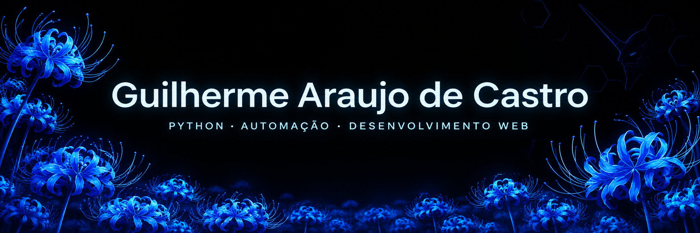
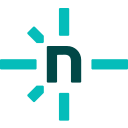
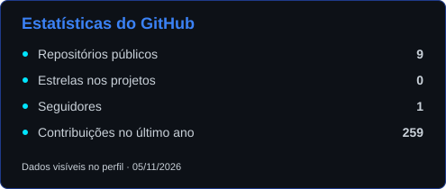
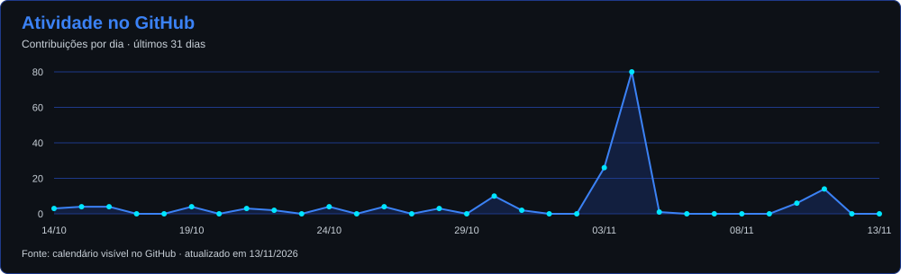

  
   
  

  <a href="https://guilhermearaujodecastro.vercel.app/">Portfólio</a> ·
  <a href="https://mail.google.com/mail/?view=cm&amp;fs=1&amp;to=guilhermeacastro.2006%40gmail.com" title="Escrever pelo Gmail">E-mail</a> ·
  <a href="https://www.linkedin.com/in/guilherme-araujo-de-castro/">LinkedIn</a> ·
  <a href="https://wa.me/5511960706601">WhatsApp</a>

🇺🇸 Read in English (Technical Summary)

I work with Python, automation and web development, with practical experience in tier 1 technical support, hardware maintenance, networking and customer service. My stack includes FastAPI, Flask, C#/.NET Core, JavaScript and SQL, with Firebase for persistence and Playwright and Selenium for browser testing. I am studying Systems Analysis and Development at UNIP and looking for opportunities in IT, support and development. My English is intermediate.

##  Sobre mim

Atuo com Python, automação e desenvolvimento web, somando experiência prática em suporte técnico N1, manutenção de hardware, redes e atendimento. Curso Análise e Desenvolvimento de Sistemas na UNIP e busco oportunidades em TI, suporte e desenvolvimento.

##  Tecnologias

###  Desenvolvimento

  
  
  
  
  
  
  
  
  

###  Dados & Ferramentas

  
  
  
  
  
  
  
  
  
  
  
  

###  Suporte & Infraestrutura

  
  
  
  
  
  
  

  
  &nbsp;&nbsp;
  

##  Projetos

<table width="100%">
  <tr>
    <td align="center" width="50%" valign="top">
      <h4>Julius</h4>
      
Bot financeiro no Telegram com Python, FastAPI e Firestore. Interpreta textos com regex, calcula valores em centavos inteiros e usa Groq opcionalmente para áudio, imagens e consultas com limite de uso.

      
    Código privado

    </td>
    <td align="center" width="50%" valign="top">
      <h4>Suporte Pro</h4>
      
Triagem de suporte ISP em HTML, CSS e JavaScript puro. Roteiros, tratativas, macros, histórico local, CSV e cache offline com Service Worker.

      
      Código privado

    </td>
  </tr>
  <tr>
    <td align="center" width="50%" valign="top">
      <h4>Controle Financeiro Gamificado</h4>
      
Finanças pessoais com entradas, gastos, orçamento, metas e investimentos. JavaScript, Firebase e Realtime Database, com XP e conquistas para acompanhar o uso.

      
     Código privado

    </td>
    <td align="center" width="50%" valign="top">
      <h4>Simulador de Batalha Pokémon</h4>
      
Batalhas por turnos em Python com cálculo de dano, ginásios e IA. Interfaces Tkinter e Flask, com equipes e reservas na web.

      
  

    </td>
  </tr>
  <tr>
    <td align="center" width="50%" valign="top">
      <h4>Team Builder Pokémon</h4>
      
Times de até seis Pokémon em ASP.NET Core. Análise de fraquezas, sugestões de membros e importação e exportação em JSON.

      
   

    </td>
    <td align="center" width="50%" valign="top">
      <h4>Analisador de Dados Pokémon</h4>
      
Python e pandas para analisar dados da PokéAPI ou de CSV. Gráficos, relatório HTML, painel web e exportação para JSON e SQLite.

      
    

    </td>
  </tr>
  <tr>
    <td align="center" width="50%" valign="top">
      <h4>Pokémon Games Tracker</h4>
      
Catálogo com progresso, notas e data de conclusão dos jogos. Dados da IGDB, login opcional e modo visitante.

      
    

    </td>
    <td align="center" width="50%" valign="top">
      <h4>Barbie Movies Tracker</h4>
      
Coleção de filmes com notas, lista para assistir, diário, resenhas e CSV. Permite compartilhar a coleção.

      
    

    </td>
  </tr>
  <tr>
    <td align="center" width="50%" valign="top">
      <h4>Web Metas</h4>
      
Metas financeiras em fila, com prazos, aportes e comparação de cenários. Orçamento mensal e backup com prévia de importação.

      
   

    </td>
    <td align="center" width="50%" valign="top">
      <h4>Corpo Bem</h4>
      
PWA de treinos, água, sono e peso. Treinos personalizados, descanso, metas diárias e recompensas com XP.

      
   

    </td>
  </tr>
  <tr>
    <td align="center" width="50%" valign="top">
      <h4>Employee Registry</h4>
      
Cadastro em Java com ordenação, agrupamento e cálculo de salários. Modo interativo no terminal, preservando o exercício original.

      
 

    </td>
    <td align="center" width="50%" valign="top">
      <h4>Monitor de Compras</h4>
      
Bot que acompanha preços e publica ofertas no Telegram, com histórico e links de afiliado.

      
   Em desenvolvimento

    </td>
  </tr>
</table>

##  Experiência profissional

- **WSNET** · Analista de Suporte Técnico N1 · 06/2026 a 09/2026
- **Resolve Lan House & Reparações** · Técnico de TI · 03/2025 a 10/2025
- **Fórum** · Assistente Administrativo (Estágio) · 01/2024 a 12/2024

##  Formação acadêmica

- **UNIP** · Superior de Tecnologia em Análise e Desenvolvimento de Sistemas · 01/2025 a 12/2026, em andamento.
- **ETEC** · Técnico em Automação Industrial · 1 ano cursado, curso incompleto.

##  Certificados e idiomas

  
  
  
  
  
  

##  Analytics

  

  

  Atualização diária · dados visíveis no GitHub. 
  <a href="https://github.com/GuilhermeAraujoDeCastro?tab=overview">Ver atividade diretamente no GitHub</a>

  
  
  

